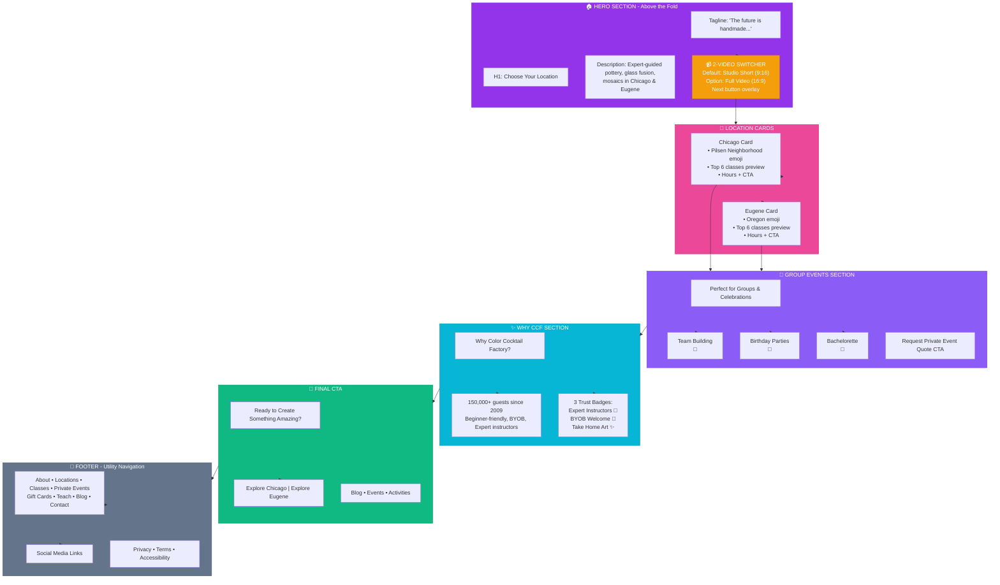

# Color Cocktail Factory - Website Structure Documentation

## Search indexing policy (November 2026)

`/chicago` and `/eugene` are real homepage routes, not rewrites. Both reuse
the homepage design, city-aware H1 and inquiry form, with the corresponding
city preselected and a self canonical. Nested city activity URLs remain
available but canonicalize to the primary activity URL and are omitted from
the sitemap; the four city-specific kids pages remain in the sitemap.
`/activities/private-parties` redirects with HTTP 301 to `/private-events`;
`/{city}/private-parties` redirects to `/private-events?city={city}`.
All three redirects explicitly use HTTP 301 rather than Next.js's default
308 for `permanent: true`. Incoming query parameters, including `city`, are
preserved on the activity redirect; city-specific redirects override any
conflicting incoming `city` while preserving the other query parameters.

After a production build, run `node tests/city-build-artifacts.mjs` before
starting or deploying it. This verifies production manifests and compiled
modules for city homepages, nested activity/gift pages and both kids routes.
Do not run development compilation against the same `.next` directory as
a build or production server: a manifest can otherwise reference deleted
modules even though route source and static parameters are correct.
With that production server running, execute
`node tests/city-routes-http.mjs http://127.0.0.1:3000` to check both city
homepages and the nested activity, gift-card and kids routes over HTTP.

Only blog articles carry a sitemap `lastModified`, using their recorded
editorial update date. No runtime timestamps are assigned to activities.

The 205 expanded workshop articles remain accessible with `noindex, follow`
and are excluded from the sitemap. Review of the 35 local guides introduced
by `7a3b4de` and `07a40c1` retains these 22 indexed articles:

- west-loop-to-pilsen-creative-date-itinerary
- bridgeport-to-pilsen-art-culture-afternoon
- chinatown-pilsen-food-art-itinerary
- things-to-do-near-uic-creative-guide
- chicago-pink-line-art-food-creative-stops
- eugene-date-ideas-beyond-coffee-15-experiences
- eugene-uo-student-family-weekend-things-to-do
- springfield-to-eugene-creative-half-day
- adult-birthday-party-ideas-eugene-groups
- eugene-family-school-break-activities
- what-do-creative-workshops-cost-comparison
- one-day-art-classes-vs-pottery-firing-comparison
- pilsen-restaurants-before-after-pottery
- chicago-paint-and-sip-alternatives
- byob-activities-chicago-guide
- chicago-date-nights-under-100
- chicago-winter-date-nights-indoors
- chicago-team-building-cost-10-20-50
- eugene-bachelorette-party-ideas-8-to-20
- rainy-day-things-to-do-eugene-oregon
- university-of-oregon-visiting-student-eugene-weekend
- holiday-party-ideas-chicago-eugene-2026

These retain distinct neighborhood routes, named local destinations,
city-specific booking logistics or substantive workshop buying guidance.
The remaining 13 local features mostly repeat generic activity lists
or overlapping seasonal roundups; they are `noindex, follow`, remain
internally linked, and are excluded from the sitemap. Their exact slugs are
maintained in `lib/blogIndexing.ts`, shared by article metadata and sitemap.
No article was deleted and no new price or venue claim was introduced.

## Page 1: Site Structure Map

```mermaid
graph TB
    HOME[Homepage<br/>colorcocktailfactory.com<br/>🎯 Location chooser + Brand intro]
    
    %% Top Level Navigation
    HOME --> CHICAGO[Chicago Location Hub<br/>/chicago<br/>📍 SEO landing page]
    HOME --> EUGENE[Eugene Location Hub<br/>/eugene<br/>📍 SEO landing page]
    HOME --> BLOG[Blog<br/>/blog<br/>📝 Content + SEO]
    HOME --> ACTIVITIES[All Activities<br/>/activities<br/>📋 Class catalog]
    HOME --> TEACH[Teach With Us<br/>/teach<br/>💼 Instructor recruitment]
    HOME --> PRIVATE[Private Events<br/>/private-events<br/>🎉 Group bookings]
    HOME --> GIFTS[Gift Cards<br/>/gift-cards<br/>🎁 E-commerce]
    
    %% Chicago Classes
    CHICAGO --> CHI_DATE[Date Night Pottery<br/>/chicago/date-night-wheel<br/>💕 High-converter]
    CHICAGO --> CHI_BEGIN[Beginner Wheel<br/>/chicago/beginner-wheel<br/>🎨 Entry point]
    CHICAGO --> CHI_HAND[Handbuilding<br/>/chicago/handbuilding<br/>🏺 Alternative]
    CHICAGO --> CHI_LAMP[Turkish Lamp<br/>/chicago/turkish-lamp<br/>✨ Premium]
    CHICAGO --> CHI_GLASS[Glass Fusion<br/>/chicago/glass-fusion<br/>🌈 Specialty]
    CHICAGO --> CHI_MOSAIC[Mosaics<br/>/chicago/mosaics<br/>🎨 Craft]
    CHICAGO --> CHI_BONSAI[Bonsai<br/>/chicago/bonsai<br/>🌱 Nature]
    
    %% Eugene Classes
    EUGENE --> EUG_DATE[Date Night Pottery<br/>/eugene/date-night-wheel<br/>💕 High-converter]
    EUGENE --> EUG_BEGIN[Beginner Wheel<br/>/eugene/beginner-wheel<br/>🎨 Entry point]
    EUGENE --> EUG_TERRA[Terrarium<br/>/eugene/terrarium<br/>🌿 Nature]
    EUGENE --> EUG_CANDLE[Candle Making<br/>/eugene/candle-making<br/>🕯️ Craft]
    EUGENE --> EUG_GLASS[Glass Fusion<br/>/eugene/glass-fusion<br/>🌈 Specialty]
    
    %% Private Events Flow
    PRIVATE --> TEAM[Team Building<br/>/team-building<br/>🤝 Corporate]
    PRIVATE --> BIRTHDAY[Birthday Parties<br/>/birthday-parties<br/>🎂 Celebrations]
    PRIVATE --> BACH[Bachelorette<br/>/bachelorette-parties<br/>💍 Groups]
    PRIVATE --> CORP[Corporate Events<br/>/corporate<br/>💼 Business]
    
    %% Blog Section
    BLOG --> BLOG_POST[Blog Posts<br/>/blog/[slug]<br/>📄 SEO content]
    
    %% Teach Section
    TEACH --> TEACH_APPLY[Apply Now<br/>/teach/apply<br/>📝 Application form]
    TEACH --> TEACH_FAQ[Instructor FAQ<br/>/teach/faq<br/>❓ Info]
    TEACH --> TEACH_PAY[Pay & Benefits<br/>/teach/pay<br/>💰 Compensation]
    TEACH --> TEACH_LOGIN[Dashboard<br/>/teach/instructors/dashboard<br/>🔐 Portal]
    
    %% Activities Section
    ACTIVITIES --> ACT_CAT[Activity Detail<br/>/activities/[slug]<br/>📖 Description]
    
    %% Booking Flow
    CHI_DATE -.->|RezClick| REZCLICK[RezClick Calendar<br/>External booking<br/>💳 Conversion]
    EUG_DATE -.->|RezClick| REZCLICK
    
    %% Thank You Pages
    PRIVATE -.->|Form submit| THANKS_PARTY[Thank You<br/>/thanks/private-party<br/>✅ Confirmation]
    TEACH_APPLY -.->|Form submit| THANKS_INST[Thank You<br/>/thanks/instructor-application<br/>✅ Confirmation]
    
    style HOME fill:#9333ea,stroke:#7c3aed,color:#fff
    style CHICAGO fill:#ec4899,stroke:#db2777,color:#fff
    style EUGENE fill:#10b981,stroke:#059669,color:#fff
    style REZCLICK fill:#f59e0b,stroke:#d97706,color:#fff
    style PRIVATE fill:#8b5cf6,stroke:#7c3aed,color:#fff
    
    classDef converter fill:#ef4444,stroke:#dc2626,color:#fff
    classDef seo fill:#3b82f6,stroke:#2563eb,color:#fff
    classDef form fill:#06b6d4,stroke:#0891b2,color:#fff
    
    class CHI_DATE,EUG_DATE converter
    class BLOG_POST,CHICAGO,EUGENE seo
    class TEACH_APPLY,PRIVATE form
```

## Page 2: Homepage Structure (Wireframe)



## Legend

| Symbol | Meaning |
|--------|---------|
| 🎯 | Primary conversion page |
| 📍 | SEO landing page (location-specific) |
| 💕 | High-converting class (date night) |
| 🎨 | Entry-point class (beginner-friendly) |
| ✨ | Premium/specialty offering |
| 📝 | Content/blog page |
| 💳 | External booking (RezClick) |
| 🎉 | Group/private event |
| 💼 | B2B/corporate |
| 🔐 | Gated/login required |
| ✅ | Confirmation/thank you page |
| 📹 | Video/media element |

## Conversion Paths

### Path 1: Individual Class Booking
```
Homepage → Chicago/Eugene Hub → Class Detail → RezClick Calendar → Booking Complete
```

### Path 2: Private Event Inquiry
```
Homepage → Private Events → Form Fill → Thank You → Follow-up Email
```

### Path 3: Gift Card Purchase
```
Homepage → Gift Cards → E-commerce Flow → Purchase Complete
```

### Path 4: Instructor Application
```
Homepage → Teach → Apply → Form Submit → Thank You → HR Review
```

## Mobile vs Desktop Considerations

### Mobile Priority (< 768px)
- Video switcher: Full-width, touch-friendly Next button
- Location cards: Stacked vertically
- Navigation: Hamburger menu
- CTAs: Full-width buttons

### Desktop Priority (≥ 1024px)
- Video switcher: Centered, hover overlay for Next
- Location cards: Side-by-side grid
- Navigation: Full horizontal pill nav
- CTAs: Inline buttons with icons
